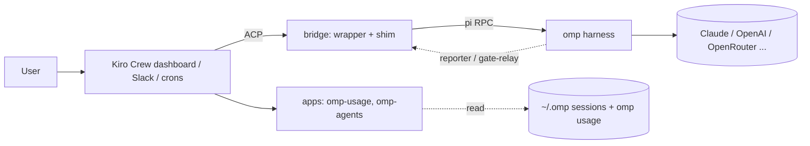

<p align="center"></p>

# Kiromp

Kiro Crew on the outside, Oh My Pi on the inside.

Kiromp is everything needed to run [Oh My Pi](https://github.com/can1357/oh-my-pi) (`omp`) as the agent harness behind [Kiro Crew](https://github.com/kirodotdev/KiroCrew), plus two Kiro Crew apps that make omp visible in the dashboard.

## Why two harnesses

Kiro Crew and omp are good at different layers, and neither wants to become the other.

Kiro Crew is the operating layer around agents. It has the dashboard, persistent memory and lessons, scheduled jobs, Slack and other channels, background sessions, artifacts, the app store and a tool gate that asks a human before risky calls. It runs whatever harness you plug into its Pi backend.

omp is the harness itself, the loop that actually reads code and edits files. Its tooling is noticeably better for real coding work: hash-anchored edits that don't drift, LSP and AST tools, a persistent eval kernel, TTSR rules that stop a bad tool call before it runs, native subagents with their own models, and one config for every model provider. Its auth gateway can also pool several provider subscriptions and load-balance across them, so we aren't locked to one vendor or one account.

Using both means we keep Crew's memory, scheduling and approvals without being stuck with a weaker inner loop, and we can swap or upgrade the inner loop without losing any of that. The cost is a protocol gap: Crew expects `pi`, and out of the box omp's subagents, steering and gate approvals don't show up in Crew. The bridge closes that gap.



## What's in here

| Path | What it is |
|---|---|
| [`bridge/`](bridge/) | The omp to Kiro Crew bridge. Puts omp behind Crew's `pi-acp` interface, streams omp subagents into Crew's Subagents tab, routes subagent tool calls through Crew's gate and supports mid-turn steering. Also includes TTSR rules and `cron-medic`, a service that starts an omp session to fix failing Crew crons. See [bridge/README.md](bridge/README.md). |
| [`apps/omp-usage/`](apps/omp-usage/) | Kiro Crew app. Shows `omp usage` per provider and account, warns at 75% and 90%, and sends a bell notification when a limit hits 90% or runs out. Adds a sidebar page and a composer chip. |
| [`apps/omp-agents/`](apps/omp-agents/) | Kiro Crew app. An Agents page with a tally of omp subagent runs, cost and token charts, per-type tables and a live transcript inspector, built from `~/.omp` session files. |

## Install

You need Kiro Crew, `omp` on your PATH, Node 20+ and Bun.

1. Bridge: follow [bridge/README.md](bridge/README.md) to point Crew's Pi backend at the wrapper.
2. Apps:

   ```sh
   kirocrew app install ./apps/omp-usage
   kirocrew app install ./apps/omp-agents
   ```

   Then enable them from the dashboard's App Store. They're third-party apps, so Crew asks you to trust each one first. That prompt is expected, and enabling from the CLI is refused until you've trusted it.

## Tests

```sh
node --test bridge/test/
(cd bridge/cron-medic && bun install && bun test)
(cd apps/omp-usage && python -m pytest -q)
(cd apps/omp-agents && python -m pytest -q)
```

Four bridge tests fail when they run inside a live Crew session, because the session's env vars leak into them. They pass in a clean shell.

## Known limits

- Crew apps can't add buttons to the top bar, so the usage monitor is a page plus a composer chip instead of a navbar button. The chip can only turn amber, not red.
- The subagent-card fixes inside Crew's chat (stable card IDs across turns, one card per run) are changes to Crew's own code and aren't included here. The bridge works without them, but cards are less tidy.
- Neither app has been run in a real dashboard yet. Both were checked against a local harness that signs requests the way the gateway does.

## License

MIT
