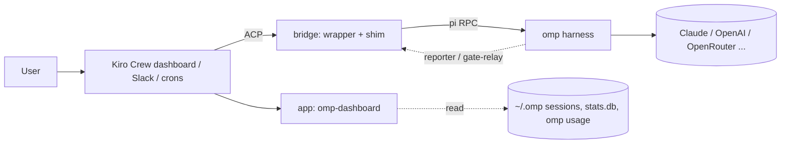

<p align="center"></p>

# Kiromp

Kiro Crew on the outside, Oh My Pi on the inside.

Kiromp is everything needed to run [Oh My Pi](https://github.com/can1357/oh-my-pi) (`omp`) as the agent harness behind [Kiro Crew](https://github.com/kirodotdev/KiroCrew), plus a Kiro Crew app that makes omp visible in the dashboard.

## Why two harnesses

Kiro Crew and omp are good at different layers, and neither wants to become the other.

Kiro Crew is the operating layer around agents. It has the dashboard, persistent memory and lessons, scheduled jobs, Slack and other channels, background sessions, artifacts, the app store and a tool gate that asks a human before risky calls. It runs whatever harness you plug into its Pi backend.

omp is the harness itself, the loop that actually reads code and edits files. Its tooling is noticeably better for real coding work: hash-anchored edits that don't drift, LSP and AST tools, a persistent eval kernel, TTSR rules that stop a bad tool call before it runs, native subagents with their own models, and one config for every model provider. Its auth gateway can also pool several provider subscriptions and load-balance across them, so we aren't locked to one vendor or one account.

Using both means we keep Crew's memory, scheduling and approvals without being stuck with a weaker inner loop, and we can swap or upgrade the inner loop without losing any of that. The cost is a protocol gap: Crew expects `pi`, and out of the box omp's subagents, steering and gate approvals don't show up in Crew. The bridge closes that gap.



## What's in here

| Path | What it is |
|---|---|
| [`bridge/`](bridge/) | The omp to Kiro Crew bridge. Puts omp behind Crew's `pi-acp` interface, streams omp subagents into Crew's Subagents tab, routes subagent tool calls through Crew's gate and supports mid-turn steering. Also includes TTSR rules and `cron-medic`, a service that starts an omp session to fix failing Crew crons. See [bridge/README.md](bridge/README.md). |
| [`apps/omp-dashboard/`](apps/omp-dashboard/) | Kiro Crew app, one sidebar page with four tabs. Overview: API-equivalent spend over 24h to 30d, a 14-day strip, the limits closest to their cap and what the agents are doing now. Spend: breakdowns by provider, model and agent type from `~/.omp/stats.db`. Limits: `omp usage` per provider and account, with a bell notification when a limit hits 90% or runs out. Agents: a tally of omp subagent runs with charts and a live transcript inspector. Adds a composer chip that opens the limits. See [apps/omp-dashboard/README.md](apps/omp-dashboard/README.md). |

## Install

You need Kiro Crew, `omp` on your PATH, Node 20+ and Bun.

1. Bridge: follow [bridge/README.md](bridge/README.md) to point Crew's Pi backend at the wrapper.
2. Dashboard app:

   ```sh
   kirocrew app install ./apps/omp-dashboard
   ```

   Then enable it from the dashboard's App Store. It's a third-party app, so Crew asks you to trust it first. That prompt is expected, and enabling from the CLI is refused until you've trusted it. It replaces the earlier `omp-usage` and `omp-agents` apps; uninstall those once it is enabled, or both will poll `omp usage` and send the same alerts.

## Tests

```sh
node --test bridge/test/
(cd bridge/cron-medic && bun install && bun test)
(cd apps/omp-dashboard && python -m pytest -q)
(cd apps/omp-dashboard/ui && npm install && bun test)
```

Four bridge tests fail when they run inside a live Crew session, because the session's env vars leak into them. They pass in a clean shell.

## Known limits

- Crew apps can't add buttons to the top bar, so the usage monitor is a tab on the dashboard page plus a composer chip instead of a navbar button. The chip can only turn amber, not red, and Crew shows at most two chips across all apps.
- Spend is API-equivalent, the list-price value of the tokens from omp's own stats database. Subscription accounts aren't billed that. The cost views are hidden when `~/.omp/stats.db` is missing.
- The subagent-card fixes inside Crew's chat (stable card IDs across turns, one card per run) are changes to Crew's own code and aren't included here. The bridge works without them, but cards are less tidy.
- The dashboard app has not been run in a real Crew dashboard yet. It was checked against a local harness that signs requests the way the gateway does, with stub host modules, so the real page mounting is unverified.

## License

MIT
