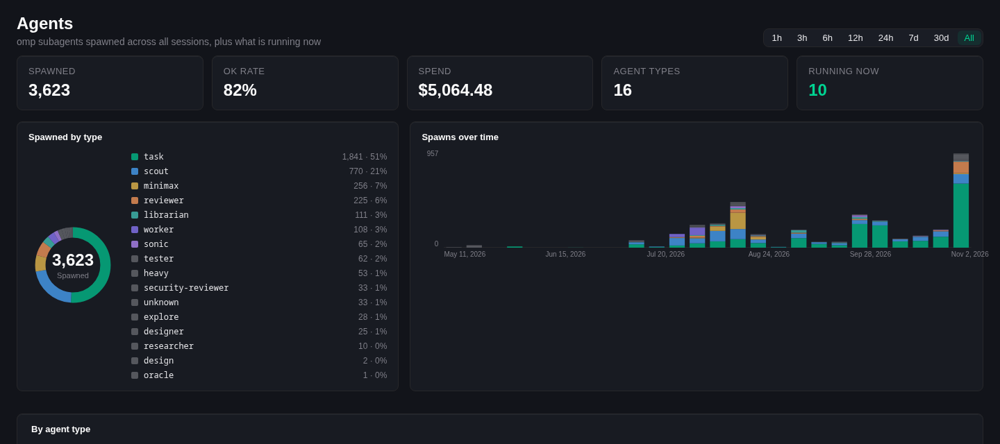

# omp Agents

A Kiro Crew dashboard page for [omp](https://github.com/can1357/oh-my-pi) subagents. It tallies every subagent omp has spawned by agent type over a time window, charts spawns over time, and opens a live transcript inspector for any running or finished run.



## What it shows

- **KPIs**: spawned, OK rate, spend, agent types, running now.
- **Charts**: spawns by type (donut) and spawns over time (stacked by type).
- **By agent type**: spawned, OK rate, errors, aborted, cost, tokens, median duration, tools per run, models, last used.
- **Running now**: running subagents and live top-level omp sessions.
- **Recent runs**: the last 100 subagent runs in the window.
- **Session inspector**: click any run to read its transcript tail (user, assistant, tool results). It refreshes every 3 s while the run is live.

Windows: 1h, 3h, 6h, 12h, 24h, 7d, 30d, all. The selection is remembered in the browser.

## Requirements

- Kiro Crew with third-party app execution allowed. The app ships a backend process, so turn on **Settings > Security > Trusted apps** (or trust this app alone from the App Store prompt). Without it, `kirocrew app enable` is refused with `blocked by execution policy: third-party app execution is disabled`.
- `omp` on `PATH`. The app only reads omp's files, but there is nothing to show without omp having run.
- `grep` on `PATH` (optional; a slower pure-Python scan is used without it).
- Linux or macOS.

## Install

```bash
kirocrew app install /path/to/omp-agents
kirocrew app enable omp-agents
```

The **Agents** entry then appears in the dashboard sidebar. The UI is a prebuilt bundle (`ui/dist/index.mjs`), so installing needs no build step.

## Data sources (read-only)

| Source | Default location | Used for |
|---|---|---|
| omp session files | `~/.omp/agent/sessions/**.jsonl` | run list, agent type (from the parent's `task` call), live detection, transcripts |
| omp stats database | `~/.omp/stats.db` | tokens, cost, model, stop reason and tool-call counts |

Override the locations with `OMP_AGENTS_SESSIONS_DIR` and `OMP_AGENTS_STATS_DB` in the environment the Kiro Crew gateway runs in.

A run is **OK** when its last tool call is `yield` or its last message stopped normally. It is **running** when its file was written in the last 120 s and the last tool call is not `yield`. The run list is cached for 30 s, so a large session tree is scanned at most once per interval.

The app never writes to omp's files and makes no network calls. Session keys are validated to resolve to a `.jsonl` file under the sessions root, so the inspector cannot read anything else. Every `/api/*` request is checked against the gateway's `X-KiroCrew-Proxy` HMAC signature.

## Layout

```
app.json              manifest (backend process + one UI page, no agents/skills/crons)
backend/server.py     stdlib HTTP server: /health, /api/runs, /api/session
backend/omp_agents.py scanning, aggregation and transcript logic
ui/src/               React UI (TypeScript), built to ui/dist/index.mjs
ui/harness/           stub SDK + page for checking the UI without a gateway
scripts/harness_server.py  signing proxy used with the harness
tests/                pytest suite
```

## Development

```bash
# backend tests
python -m venv .venv && .venv/bin/pip install pytest
.venv/bin/pytest

# UI: typecheck and rebuild the committed bundle
cd ui && npm install && npm run typecheck && npm run build

# UI without a gateway
npm run harness
export KIROCREW_PROXY_SECRET=dev-secret
PORT=9101 python ../backend/server.py &
python ../scripts/harness_server.py --backend 9101 --port 9102
# open http://127.0.0.1:9102/?theme=dark   (or ?theme=light)
```

The harness page renders the real UI against the real backend, with stand-ins for `@kirocrew/app-sdk` and `@kirocrew/app-sdk/ui`. It approximates the dashboard's look; it is not the dashboard.

## License

MIT
