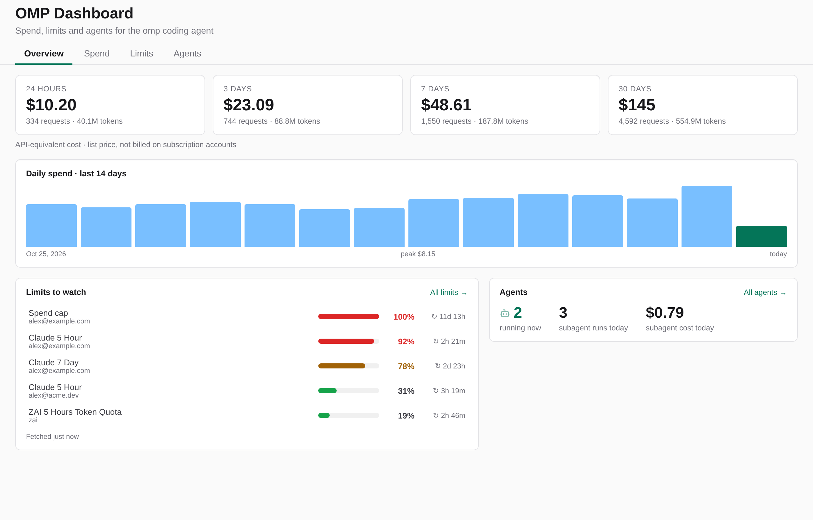
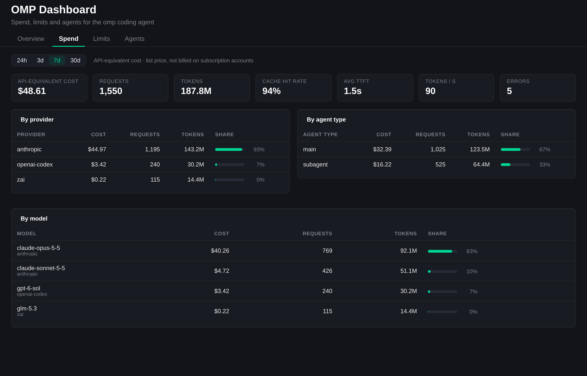
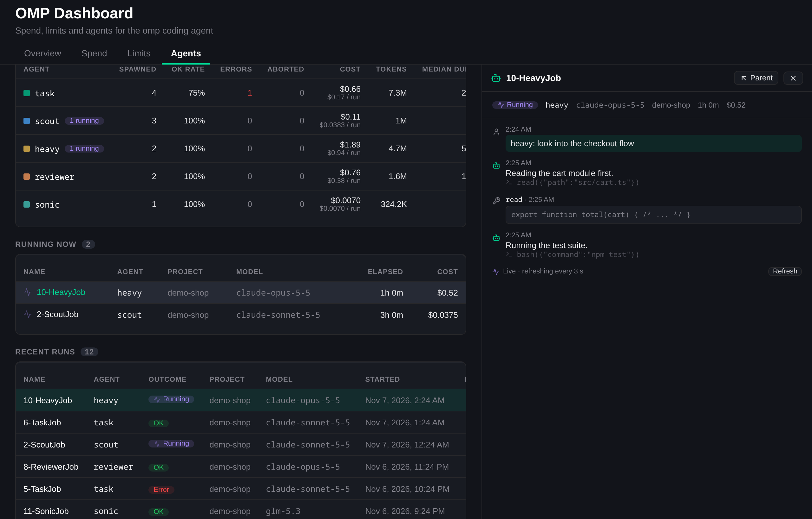
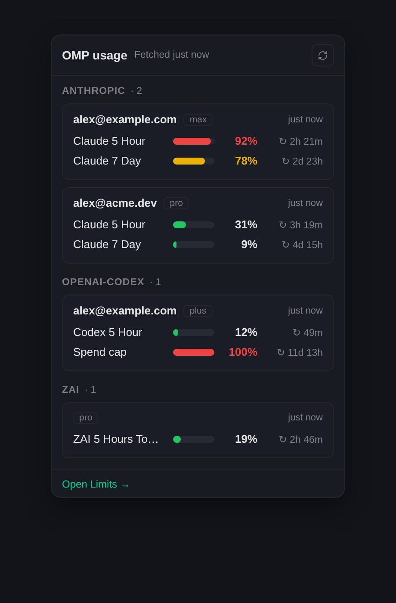

# OMP Dashboard

A Kiro Crew app that puts the [omp](https://github.com/can1357/oh-my-pi) coding agent on one dashboard page: what it
costs, which limits are about to run out, and what its subagents are doing. It replaces the separate `omp-usage` and
`omp-agents` apps and adds the spend view.

It reads omp's own data, read-only: `omp usage --json`, `~/.omp/stats.db` and the session files under
`~/.omp/agent/sessions`. Nothing is written to omp.



## The page

One sidebar page, **OMP Dashboard** (`/apps/omp-dashboard`), with four tabs. The tab is kept in the URL
(`?tab=overview|spend|limits|agents`, plus `&window=` on Spend), so a reload or a shared link lands where you were.

- **Overview.** Cost tiles for 24 hours, 3 days, 7 days and 30 days (click one to open it on the Spend tab), a 14-day
  daily spend strip, *Limits to watch* (the five limits closest to their cap, across all accounts, with reset
  countdowns) and an Agents row (running now, subagent runs today, subagent cost today). Each card links to its tab.
- **Spend.** A 24h / 3d / 7d / 30d selector, then cache-hit rate, average time to first token, tokens per second and
  error count, with breakdowns by provider, model and agent type (main vs subagent) and a share bar on each row.
- **Limits.** One row per limit, grouped by provider with each account in its own card. Amber from 75% used, red from
  90% or exhausted. It paints the cached reading, asks for a fresh one on open, then re-reads every minute.
- **Agents.** Spawned / OK rate / spend / agent types / running now, a donut and a timeline by agent type, a per-type
  table, the running list, recent runs, and an inspector drawer that tails any run's transcript (every 3 s while it runs).



All costs are labelled **API-equivalent**: the list-price value of the tokens, which omp computes per message.
Subscription accounts are not billed that. If `~/.omp/stats.db` does not exist, the cost tiles and the Spend tab are
hidden instead of showing an error.



### Composer chip and notifications

- A **composer chip** (the lightning-bolt chip beside the agent and model chips) opens a compact limits popover with an
  *Open Limits →* link to the Limits tab. It tints amber from 75% and shows the busiest limit on hover. Apps cannot add
  top-bar buttons, and a chip has only two tints, so unlike a top-bar badge it cannot also turn red; the page does.
  The dashboard shows at most two session controls across all apps, so with others installed the chip can be dropped.
- **Bell notifications**, sent by the backend whether or not a tab is open: one when a limit reaches 90% and one when it
  is exhausted, each at most **once per limit, account and reset window**, on the *OMP usage alerts* channel (mute it
  under Settings → Notifications). They link to the Limits tab. What was announced is kept in the app's data directory,
  so a restart does not re-announce, and a note the gateway refuses is retried on the next poll.



## Requirements

- Kiro Crew 0.13 or newer.
- The `omp` CLI on the machine that runs Kiro Crew (found via `$OMP_BIN`, then `PATH`, then `~/.bun/bin`,
  `~/.local/bin`, `/usr/local/bin`). It is only needed for Limits and alerts; Spend and Agents read files.
- Python 3 (the interpreter Kiro Crew already runs). The backend uses the standard library only.

## Install

```bash
kirocrew app install /path/to/omp-dashboard
```

then enable it from the dashboard's App Store. Kiro Crew refuses third-party app code until you trust it, so the
enable prompt asks for that first; enabling from the CLI is refused until then
(`blocked by execution policy: third-party app execution is disabled`). The UI ships prebuilt in `ui/dist/`.

If you have the older `omp-usage` or `omp-agents` apps, uninstall them once this one is enabled. They would otherwise
both poll `omp usage` and send the same alerts.

## Configuration

All optional.

| Variable | Default | Purpose |
|---|---|---|
| `OMP_BIN` | `omp` on `PATH` | The omp executable |
| `OMP_DASHBOARD_STATS_DB` | `~/.omp/stats.db` | omp's stats database (opened read-only) |
| `OMP_DASHBOARD_SESSIONS_DIR` | `~/.omp/agent/sessions` | omp's session files |
| `OMP_DASHBOARD_DATA_DIR` | `<crew home>/apps/omp-dashboard/data` | Where the alert ledger lives |

## Backend

One loopback process (`backend/server.py`, standard library only) behind the gateway's reverse proxy.
`/apps/omp-dashboard/api/<path>` reaches it as `/api/<path>`; every route except `/health` requires the gateway's
`X-KiroCrew-Proxy` HMAC.

| Route | What |
|---|---|
| `GET /health` | liveness (unsigned) |
| `GET /api/usage[?refresh=1]` | cached `omp usage --json`, 5-minute background poll, single-flight; `refresh=1` forces a refetch |
| `GET /api/status` | `{state, tooltip}` for the composer chip |
| `GET /api/spend[?window=24h\|3d\|7d\|30d]` | window totals, plus for the chosen window the summary, provider / model / agent-type breakdowns and 14 local days, all aggregated in SQL; cached 60 s |
| `GET /api/runs` | every omp session and subagent run, cached 30 s |
| `GET /api/session?key=&tail=` | transcript tail of one run |

Modules: `usage.py` (limits, alert dedupe and ledger), `spend.py` (SQL), `agents.py` (session scan and transcripts),
`gateway_notify.py` (pushes through `POST /api/notifications/push` using the injected origin, only after its proof
verifies against the app secret), `paths.py` (locations and env overrides), `server.py`.

Cache-hit rate is cache-read tokens over all prompt tokens (input + cache read + cache write). Tokens per second is
output tokens over generation time, summed across requests, not an average of per-request rates. Daily buckets are
local days.

## Development

```bash
python -m pip install pytest
python -m pytest                      # backend, 76 tests

cd ui
npm install
npm run build                         # -> dist/page.mjs and dist/control.mjs (commit them)
npm run typecheck
bun test                              # pure UI helpers
```

To look at the UI without a gateway, with made-up data:

```bash
python scripts/demo_data.py /tmp/omp-demo
export OMP_BIN=/tmp/omp-demo/omp OMP_DASHBOARD_STATS_DB=/tmp/omp-demo/stats.db \
       OMP_DASHBOARD_SESSIONS_DIR=/tmp/omp-demo/sessions OMP_DASHBOARD_DATA_DIR=/tmp/omp-demo/data \
       KIROCREW_PROXY_SECRET=dev-secret PORT=9831
python backend/server.py &
(cd ui && npm run harness)            # builds ui/harness/dist against stub host modules
python scripts/harness_server.py --backend 9831 --port 9832
# open http://127.0.0.1:9832/?tab=overview   (add &theme=light, or ?view=control for the chip)
```

The harness signs requests the way the gateway does, but its host SDK is a stub: it checks this app, not the
dashboard's real page mounting.

## License

MIT
