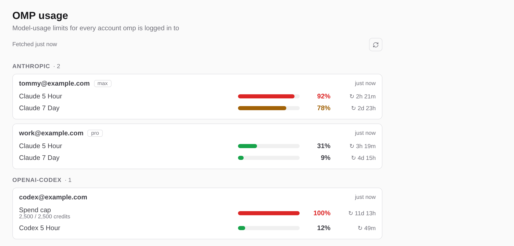
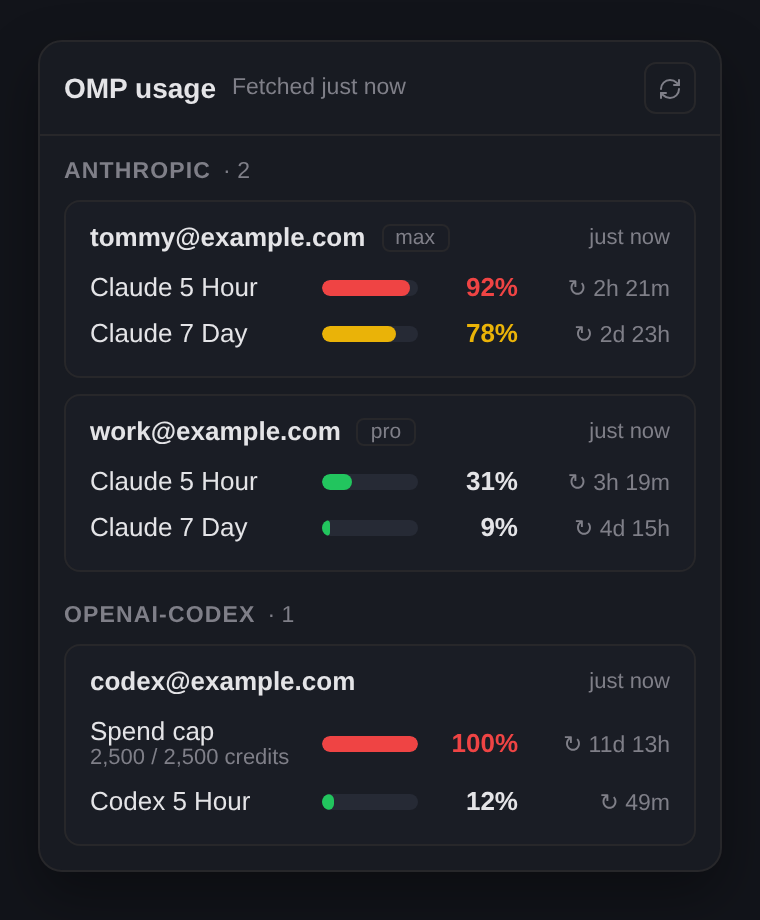

# OMP Usage

A Kiro Crew app that shows how much of each model quota your `omp` accounts have used, and rings the bell
before one runs out.

It wraps `omp usage --json`, which asks every logged-in provider account for its limits, and presents one row
per limit — bar, percentage, reset time — grouped by provider, with each account in its own card.



## What you get

- **A sidebar page, "OMP Usage".** One row per limit; amber from 75% used, red from 90% or when the limit is exhausted.
  It paints the cached snapshot immediately, asks for a fresh reading on open, then re-reads the cache every 60 s
  while visible. The refresh button forces a new `omp usage` call.
- **A composer chip** (the lightning-bolt chip beside the agent/model chips). Click it for the same view in a
  compact popover; hover it for "OMP usage: NN% used on the busiest limit". The chip tints amber from 75%.
- **Bell notifications**, sent by the backend whether or not a dashboard tab is open: one when a limit reaches
  90% and one when it is exhausted, each at most **once per limit, account and reset window**. They arrive on the
  *OMP usage alerts* channel (mute or re-prioritise it under Settings → Notifications) and link back to the page.
  The record of what was announced lives in the app's data directory, so restarting the gateway does not
  re-announce a limit that is still near its cap. A note the gateway refuses is not recorded and is retried on the
  next poll.
- **Background polling every 5 minutes**, with concurrent requests collapsed into one `omp` subprocess and the last
  good reading kept (with the error shown) if a fetch fails.



## Requirements

- Kiro Crew 0.13 or newer.
- The `omp` CLI on the machine that runs Kiro Crew. The backend finds it via `$OMP_BIN`, then `PATH`, then
  `~/.bun/bin/omp`, `~/.local/bin/omp` and `/usr/local/bin/omp`.
- Python 3 (the interpreter Kiro Crew already runs). The backend uses the standard library only.

## Install

```bash
kirocrew app install /path/to/omp-usage
kirocrew app enable omp-usage
```

The UI ships prebuilt in `ui/dist/`, so no build step is needed.

Kiro Crew refuses to run third-party app code by default. If `enable` answers
`blocked by execution policy: third-party app execution is disabled`, trust this app from the dashboard's App Store
(its install/enable prompt asks for it) or set `agent.apps_trusted` / `agent.apps_allow_third_party` — see the
Kiro Crew docs. The app declares only `/apps/omp-usage/api` for the UI and one notification channel; it needs no
network permission of its own (`omp` makes the provider calls).

## Why a page and a composer chip, not a top-bar button

Apps cannot add top-bar buttons. The App Kit's closest equivalent to "a small always-visible button with a popover
and a status dot" is a **session control**: a chip in the composer bar that opens an app-owned popover and can be
tinted from a status route. This app uses one (`contributes.sessionControls`, `statusPath: "status"`) alongside the
required sidebar page. Limits of that surface, from the manifest reference:

- the chip has two tints (`ok` / `warn`), so it turns amber from 75% and cannot also turn red at 90%; the exact
  percentage is in its tooltip and the page shows red;
- the dashboard renders at most two session controls across all apps, so with several contributing apps the chip can
  be dropped;
- the popover is a fixed 340 px wide, hence the compact layout.

The sidebar page is the full view. A chat side-panel tab (`contributes.panelTabs`) would also work but is only
visible while that panel is open.

## How it works

```
dashboard page / chip ──GET /apps/omp-usage/api/usage[?refresh=1]──▶ gateway proxy (HMAC-signs)
                                                                          │
                                       backend/server.py  ◀───────────────┘   verifies X-KiroCrew-Proxy
                                          │  OmpUsageService (cache, single-flight, 5-min poller)
                                          ├─ `omp usage --json`
                                          └─ alert at ≥90% / exhausted ─▶ POST {gateway}/api/notifications/push
```

- `backend/omp_usage.py` — fetch, cache, alert extraction/dedupe/ledger.
- `backend/gateway_notify.py` — pushes through the documented `POST /api/notifications/push` API: it trusts the
  injected `KIROCREW_GATEWAY_ORIGIN` only if its `KIROCREW_GATEWAY_ORIGIN_PROOF` verifies, exchanges the app secret
  for an app token, and posts to the declared `usage-alerts` channel.
- `backend/server.py` — loopback HTTP server (`/health`, `/api/usage`, `/api/status`); every route but `/health`
  requires the gateway's `X-KiroCrew-Proxy` HMAC.
- `ui/src` — React page and chip bundled to `ui/dist/*.mjs`; React, `@kirocrew/app-sdk` and `lucide-react` come
  from the host's import map. Styling uses the dashboard's CSS variables (`--bg-elevated`, `--text`, `--muted`,
  `--ok`, `--warn`, `--danger`, …), so it follows the light and dark themes.

`omp usage` reports per-model histories of hundreds of KB; the backend keeps only the account fields the UI reads
(`email`, `accountId`, `orgName`, `planType`).

## Development

```bash
# backend (stdlib only; pytest is the only test dependency)
python -m pip install pytest
python -m pytest

# UI: rebuild the committed bundles, type-check, unit-test the pure helpers
cd ui
npm install
npm run build        # -> dist/page.mjs and dist/control.mjs (commit them)
npm run typecheck
bun test
```

To exercise the backend without a gateway:

```bash
OMP_USAGE_ALLOW_UNSIGNED=1 OMP_USAGE_DATA_DIR=/tmp/omp-usage PORT=9100 python backend/server.py
curl 'localhost:9100/api/usage?refresh=1'
```

## License

MIT
