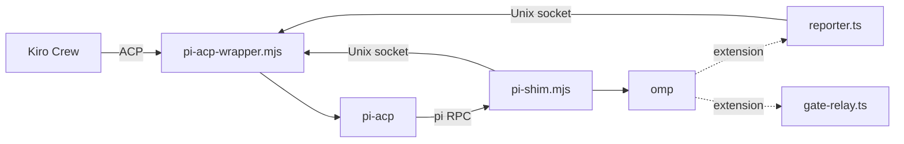

<p align="center"></p>

# omp ↔ Kiro Crew bridge

Runs [Oh My Pi](https://github.com/can1357/oh-my-pi) (`omp`) as Kiro Crew's Pi backend. Kiro Crew's Pi backend drives `pi` through `pi-acp`; this bridge puts `omp` behind that interface, then fills in the protocol gaps. omp's subagents show up in Crew, Crew's tool gate still covers them, and mid-turn steering works.



## Components

| File | Role |
|---|---|
| [`pi-acp-wrapper.mjs`](pi-acp-wrapper.mjs) | Proxy around the real `pi-acp`. Injects subagent and session updates for Crew, and routes Crew's `_session/steer` requests to the right shim. |
| [`pi-shim.mjs`](pi-shim.mjs) | Stands in for the `pi` binary. Translates arguments for `omp`, answers `get_commands` from omp's own command list, and handles hang-up and steering. |
| [`reporter.ts`](reporter.ts) | omp extension. Streams each subagent's tool calls, text and completion to the wrapper's socket. Does nothing when the socket isn't set. |
| [`gate-relay.ts`](gate-relay.ts) | Loads Crew's tool-gate extension so that subagent tool calls are approved through the parent session's UI instead of being refused. |
| [`protocol.mjs`](protocol.mjs) | Shared constants and a fail-open socket client. |
| [`rules/`](rules/) | omp TTSR rules for Kiro-run sessions only. They stop a tool call that Crew's gate would deny before it runs, because a single denied call marks the whole Crew run as failed. They never loosen the gate. To install, symlink this folder as `~/workplace/kirocrew-workspace/.agents/rules`. omp finds `.agents/rules` by walking up from the session's working directory, so only sessions under Crew's workspace load the rules. Subagents inherit them. Check with `omp ttsr list` from a folder under that workspace. |
| [`cron-medic/`](cron-medic/) | Separate service: watches Kiro Crew cron history and starts an omp session to fix failing jobs. See its [README](cron-medic/README.md). |

## Environment

| Variable | Default | Purpose |
|---|---|---|
| `PI_ACP_REAL` | `~/.kiro/crew/pi-acp/node_modules/pi-acp/dist/index.js` | The real `pi-acp` the wrapper spawns |
| `OMP_BIN` | `~/.bun/bin/omp` | The `omp` binary the shim runs |
| `KIROCREW_OMP_BRIDGE_SOCK` | set by the wrapper | Socket the shim and reporter send to |
| `KIROCREW_OMP_GATE_TARGET` | set by the shim | Path to Crew's real tool-gate extension |

## Tests

```sh
node --test test/
cd cron-medic && bun install && bun test
```
